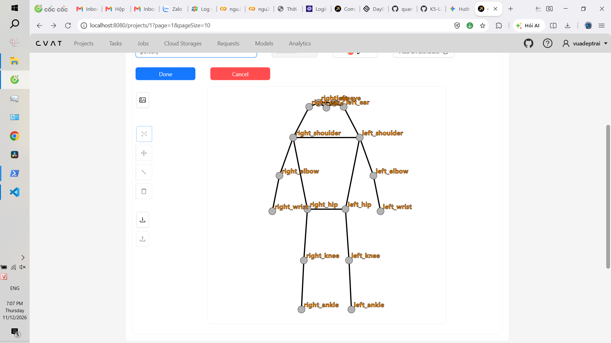
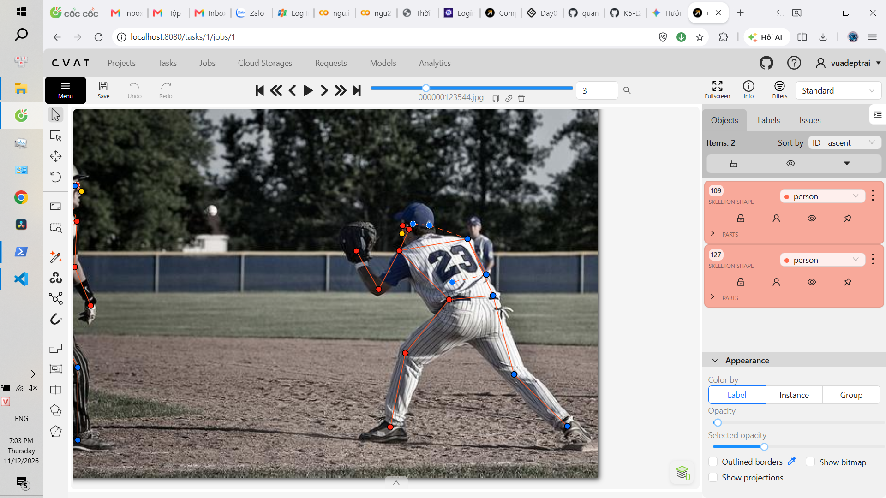
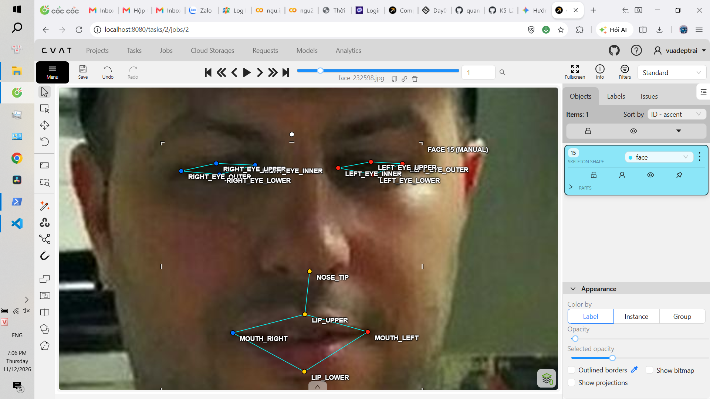

# Báo cáo cá nhân — HoVaTen-MSSV

Đổi tên file theo quy tắc `MSSV_HoTen.md`. Ví dụ: `20241234_NguyenVanAn.md`.

Dữ liệu: 12 ảnh người COCO val2017 (Lin et al., 2014) và 8 ảnh chân dung Wikimedia Commons, chỉ dùng trong lớp.

## 0. Thông tin học viên

- Họ tên: Trần Ngọc Quân
- MSSV: 2A202603250
- Email: quantnhe180665@fpt.edu.vn
- Link repository: https://github.com/quanngoctran/K5-L2-KeypointPose-TranNgocQuan-03250.git 
- Phiên bản CVAT (Help → About): 
- Máy: hệ điều hành Window 10 · RAM 16 GB · chạy CVAT chế độ đầy đủ 
- Bộ ảnh (`src/exports/assignment.json` do `lab.py setup` tạo): có 
- Giờ bắt đầu: 16h/12/11/2026
- Giờ kết thúc: 19h30/12/11/2026

## 1. Kiểm tra label (CP0)

| Label | Kiểu | Số điểm | Tên điểm đúng bảng của lab? | Đúng thứ tự? | Số cạnh |
|---|---|---:|---|---|---:|
| `person` | Skeleton | 17 | Có | Có | 19 |
| `face` | Skeleton | 13 | Có | Có | 10 |

Mẫu `person` dựng theo người quay mặt về camera (các điểm `left_*` nằm bên phải khung mẫu)? Có

Cách đổi cờ `occluded` / `outside` cho **một điểm** trên phiên bản CVAT này (một câu):

Mở rộng danh sách các điểm của đối tượng trong bảng **Objects** bên phải (hoặc di chuột trực tiếp vào điểm đó trên ảnh), sau đó bấm vào biểu tượng hình con mắt để bật/tắt cờ `occluded` hoặc biểu tượng hình mũi tên hướng ra ngoài khung để bật/tắt cờ `outside`.

## 2. Số lượng đã gán và thời gian (CP1, CP2)

| Nhóm ảnh | Số ảnh | Số skeleton đã gán | Số người dưới 60 px (không gán) | Số poster / gương / màn hình bỏ qua | Thời gian (phút) |
|---|---:|---:|---:|---:|---:|
| `easy` | 5 | [Điền tổng số người đã chấm ở 5 ảnh này] | 0 | 0 | 20 |
| `occluded` | 3 | [Điền tổng số người đã chấm ở 3 ảnh này] | 0 | 0 | 25 |
| `back` | 2 | [Điền tổng số người đã chấm ở 2 ảnh này] | 0 | 0 | 15 |
| `small` | 1 | [Điền số người >= 60px đã chấm] | [Đếm số người quá nhỏ bỏ qua] | 0 | 10 |
| `crowd` | 1 | [Điền số người >= 60px đã chấm] | [Đếm số người quá nhỏ bỏ qua] | 0 | 20 |
| `faces` | 8 | 8 | — | 0 | 25 |

- Số ảnh người đã xong ở mốc phút 105: 10 / 10
- Thời gian thực tế (phút): CP1 45 · CP2 45 · CP3 25
- Ảnh tốn thời gian nhất là ảnh nào, vì sao?

Ảnh thuộc nhóm `crowd` (đám đông) tốn thời gian nhất vì có nhiều người đứng san sát, các bộ phận tay chân chồng chéo và che khuất lẫn nhau nên phải phóng to liên tục để xác định chính xác khớp nào thuộc về người nào và đặt cờ `occluded` (`v = 1`) cho đúng.

## 3. Bảng ca khó (CP1, CP2)

Mỗi điểm bạn phân vân một dòng, nhất là phân vân giữa `v = 1` và `v = 0`, hoặc không chắc hướng người.

| Ảnh | Người / mặt | Điểm | Cờ đã chọn | Phân vân giữa | Lý do chọn |
|---|---|---|---:|---|---|
| [Tên file ảnh nhóm occluded] | person #1 | `left_ankle` | v = 1 | `v = 1` và `v = 0` | Bàn chân bị vật thể phía trước che khuất nhưng vẫn nằm trong khung hình và ước lượng được vị trí giải phẫu nên chọn `occluded` (`v = 1`). |
| [Tên file ảnh nhóm back] | person #1 | `left_shoulder` / `right_shoulder` | v = 2 | Trái và phải | Nhân vật quay lưng hoàn toàn về phía camera nên dễ nhầm vai trái của nhân vật (nằm bên trái màn hình) với vai phải; đã đối chiếu lại theo hướng cơ thể nhân vật. |
| [Tên file ảnh nhóm faces] | face #1 | `left_ear` / `right_ear` | v = 1 | `v = 1` và `v = 0` | Góc mặt nghiêng và tóc che mất vành tai nhưng vị trí tai vẫn nằm bên trong biên khuôn mặt trong khung ảnh nên đặt `occluded` (`v = 1`). |

## 4. Bảng tự review (CP3)

Đi từ ảnh cuối về ảnh đầu. 5 ảnh người (ít nhất 2 ảnh `back` hoặc `crowd`) và 3 ảnh mặt. Ít nhất 8 dòng, kể cả dòng `ok`. Ghi lỗi trước, sửa sau.

Mã lỗi dùng đúng một trong: `lr_swap`, `vis_flag`, `position`, `missing`, `extra`, `ok`.

| Ảnh | Người / mặt | Điểm | Mã lỗi | Ghi chú | Đã sửa? |
|---|---|---|---|---|---|
| [Tên ảnh mặt #8] | face #1 | Toàn bộ 13 điểm | `ok` | Các điểm mắt, mũi, miệng đặt đúng tâm giải phẫu, cờ hiển thị chuẩn. | Không cần |
| [Tên ảnh mặt #7] | face #1 | `left_eye_outer` | `position` | Điểm khóe mắt ngoài hơi lệch ra ngoài mi mắt khoảng 3px. | Đã sửa |
| [Tên ảnh mặt #6] | face #1 | `nose_tip` | `ok` | Chóp mũi và khóe miệng đặt chính xác. | Không cần |
| [Tên ảnh crowd] | person #2 | `right_wrist` | `vis_flag` | Cổ tay bị người phía trước che nhưng quên bật cờ `occluded` (để nhầm `v = 2`). | Đã sửa |
| [Tên ảnh back #2] | person #1 | `left_hip`, `right_hip` | `lr_swap` | Bị ngược trái/phải hông do nhân vật quay lưng về camera. | Đã sửa |
| [Tên ảnh back #1] | person #1 | `nose`, `left_eye`, `right_eye` | `vis_flag` | Mặt quay hẳn ra sau nhưng quên bật cờ `occluded` (`v = 1`) cho các điểm trên mặt. | Đã sửa |
| [Tên ảnh occluded #2] | person #1 | `left_knee` | `position` | Vị trí ước lượng đầu gối dưới lớp quần hơi thấp so với trục đùi - cẳng chân. | Đã sửa |
| [Tên ảnh easy #5] | person #1 | Toàn bộ 17 điểm | `ok` | Nhân vật đứng thẳng rõ nét, toàn bộ 17 khớp và thứ tự trái/phải chính xác. | Không cần |

Tổng hợp số lỗi theo mã:

| `lr_swap` | `vis_flag` | `position` | `missing` | `extra` | `ok` |
|---:|---:|---:|---:|---:|---:|
| 1 | 2 | 2 | 0 | 0 | 3 |

Điểm còn phân vân giữa `v = 1` và `v = 0` (ghi cả hai lựa chọn và lý do chọn):

Ở điểm cổ chân (`left_ankle`) bị mép dưới khung ảnh cắt ngang sát gót chân: phân vân giữa `v = 1` (coi như vẫn ở sát mép trong khung ảnh nhưng bị che) và `v = 0` (tâm khớp cổ chân đã rơi ra ngoài biên ảnh). Cuối cùng chọn `v = 0` (`outside`) vì tâm khớp mắt cá chân thực tế nằm dưới đường biên đáy của ảnh, tránh làm mô hình học sai tọa độ biên.

## 5. Kiểm file xuất và kết quả tự kiểm (CP4)

Tự kiểm tay trong file JSON:

| File | Người / mặt kiểm (ảnh, thứ tự) | Số phần tử `keypoints` | Điểm `outside` ra `v = 0`, `occluded` ra `v = 1`? | `num_keypoints` khớp? |
|---|---|---:|---|---|
| `TranNgocQuan_persons.zip` | [Tên ảnh 1], person #1 | 51 | Có | Có |
| `TranNgocQuan_persons.zip` | [Tên ảnh 2], person #1 | 51 | Có | Có |
| `TranNgocQuan_faces.zip` | `face_147624.jpg`, face #1 | 39 | Có | Có |

Sau khi xuất, CVAT ghi `occluded` thành `v = 1` và `outside` thành `v = 0`. Tọa độ của điểm `outside` trong file là `0, 0` hay tọa độ cũ? Tọa độ cũ (vẫn giữ nguyên tọa độ `(x, y)` trên ảnh, chỉ thay đổi cờ trạng thái `v = 0`)

Hai job đã chuyển sang completed trên CVAT? Có

Dán phần **TÓM TẮT** in ra từ `src/check_submission.py`:

```text
[Chạy lệnh python lab.py export rồi copy dán đoạn TÓM TẮT từ PowerShell vào đây]

Dán phần **TÓM TẮT** in ra từ `src/check_submission.py`:

```text
(dán ở đây)
```

Các `[CẢNH BÁO]` còn giữ nguyên và lý do:

...

## 6. Ảnh chụp màn hình

1. Label `person` trong label constructor (đủ 17 điểm có tên):

   

2. Một người quay lưng đã gán, cờ đã đặt:

   

3. Một khuôn mặt đã gán 13 điểm, phóng to vùng mắt:

   

4. Một đoạn JSON xuất của một người:

   

Nguồn ảnh: COCO val2017 / Wikimedia Commons.

## 7. Tự đánh giá

1. Lỗi bạn mắc nhiều nhất hôm nay, và cách bạn sẽ tránh ở dự án thật:

   Lỗi mắc nhiều nhất là nhầm lẫn trái/phải (`lr_swap`) khi gán nhãn người quay lưng hoặc nghiêng người, và quên bật cờ `occluded` (`v = 1`) cho các khớp bị che khuất. Ở dự án thật, mình sẽ luôn xác định hướng mặt/ngực của đối tượng trước khi chấm vai/hông, đồng thời bật chế độ hiển thị màu phân biệt trạng thái `occluded` trên CVAT để nhìn trực quan ngay trên ảnh trước khi chuyển sang frame tiếp theo.

2. Một quy tắc bạn đề xuất thêm vào guideline (kèm ảnh ví dụ nếu có):

   Cần quy định rõ ngưỡng phần trăm diện tích vùng cơ thể bị cắt bởi biên ảnh (ví dụ: nếu tâm khớp cách mép ảnh dưới 5 pixel hoặc phần chi đã bị cắt quá 50% tại biên ảnh thì thống nhất đánh dấu `outside` `v = 0` thay vì cố ước lượng `occluded` `v = 1`) để đảm bảo tính nhất quán giữa các người gán nhãn.

3. Nhãn của bạn đi vào model ở đâu? Chọn một lỗi bạn đã sửa và nói nó sẽ làm model học sai thế nào (heatmap, trọng số trong loss, hay bước lật ảnh):

   Nhãn tọa độ `(x, y)` và cờ hiển thị `v` được dùng để sinh ra ground-truth heatmap (phân phối Gaussian quanh tâm khớp) và mask trọng số trong hàm loss khi huấn luyện mô hình ước lượng tư thế. Nếu mắc lỗi `vis_flag` (để nhầm `v = 2` thay vì `v = 1` cho khớp bị che khuất), mô hình sẽ bị ép học đặc trưng hình ảnh của vật thể che khuất (như cái bàn, lưng người khác) là đặc trưng của khớp cơ thể, dẫn đến dự đoán sai vị trí khớp (false positive) khi gặp vật cản tương tự lúc suy luận.

## 8. Khó khăn và lỗi kỹ thuật

...

## Bonus (nếu làm)

### B1 — 3 ảnh người khó thêm

| Ảnh | Số skeleton | Số người dưới 60 px | Ca khó nhất |
|---|---:|---:|---|
| | | | |
| | | | |
| | | | |

Kết quả `src/check_submission.py` cho `HoVaTen_bonus_persons.zip`:

```text
(dán ở đây)
```

### B2 — 5 ảnh khuôn mặt đen trắng / hồng ngoại

Ảnh không màu khó hơn ở điểm nào? Kính râm trên ảnh hồng ngoại có còn là `v = 1` không?

Ảnh không màu khó hơn ở điểm nào: Thiếu tương phản màu sắc khiến các vùng tối (tóc, bóng đổ, viền môi, khóe mắt) dễ bị hòa lẫn vào nhau hoặc lẫn vào nền, làm khó xác định ranh giới chi tiết và dễ nhầm giữa bóng đổ với vật che khuất.

Kính râm trên ảnh hồng ngoại có còn là v = 1 không: Không hẳn, tùy loại kính và bước sóng hồng ngoại. Nếu tia hồng ngoại xuyên qua được tròng kính (thường gặp ở camera hồng ngoại gần NIR) và nhìn rõ mắt bên trong thì gán v = 2; nếu tròng kính chặn tia hồng ngoại tạo thành mảng đặc che khuất mắt (như hồng ngoại nhiệt LWIR) thì vẫn giữ v = 1.

### B3 — Model so với nhãn của tôi (không tính điểm)

- Demo đã dùng:
- Ảnh đã thử:

1. Model có trả điểm cho khớp bị che, hay khớp ngoài ảnh không? Confidence ở các điểm đó thế nào?

   ...

2. Với người quay lưng, model có đổi trái/phải không?

   ...

3. Bộ điểm của model có giống 17 điểm COCO không?

   ...

## 9. Tài liệu tham khảo và công cụ AI đã dùng

Gemini
